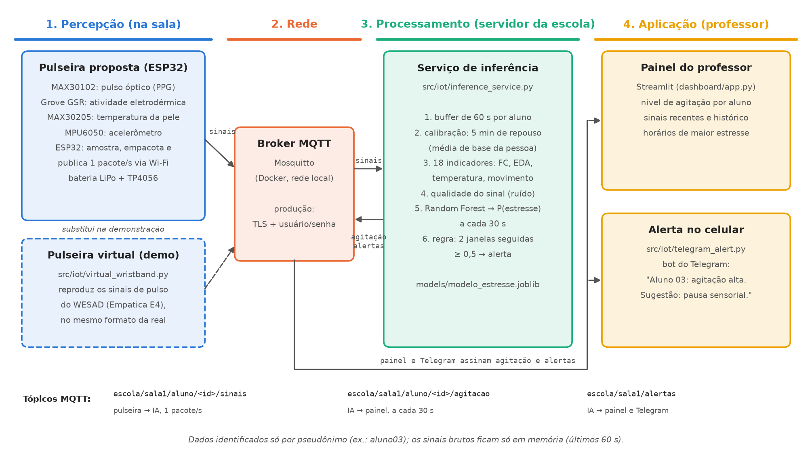

# Pulseira Inteligente para Alunos com TEA

> Detecção de sinais de estresse com IoT e inteligência artificial: uma pulseira de baixo custo envia sinais fisiológicos por MQTT, um modelo de aprendizado de máquina estima a probabilidade de estresse e o professor recebe um alerta no celular antes do pico de uma possível crise.

Trabalho final da disciplina **Internet das Coisas e Aplicações de IA (Big Data)**, Unisinos, 2026.

- 📄 **Relatório técnico:** [docs/relatorio/relatorio_iot_pulseira_tea.pdf](docs/relatorio/relatorio_iot_pulseira_tea.pdf)
- 🎥 **Vídeo pitch e demo:** [docs/video/video-apresentacao.mp4](docs/video/video-apresentacao.mp4)

---

## Sumário

1. [O problema](#1-o-problema)
2. [A solução](#2-a-solução)
3. [Arquitetura](#3-arquitetura)
4. [Principais resultados](#4-principais-resultados)
5. [Como executar](#5-como-executar)
6. [Estrutura do repositório](#6-estrutura-do-repositório)
7. [Limitações e ética](#7-limitações-e-ética)
8. [Referências e licença](#8-referências-e-licença)

---

## 1. O problema

Crises de desregulação são comuns entre alunos com Transtorno do Espectro Autista (TEA) e parecem surgir "do nada", porque muitos alunos têm dificuldade de comunicar o próprio estado. Na escola inclusiva, o professor da turma comum costuma ser o único adulto presente para perceber os sinais. Em 2025, havia 1,3 milhão de matrículas de estudantes com TEA no Brasil (Inep), e só 31,7% das escolas que recebem alunos da educação especial em classes comuns tinham profissional de apoio.

Estudos com jovens com TEA mostram que sinais fisiológicos medidos no pulso permitem prever crises de 1 a 3 minutos antes (Goodwin et al., 2019; Imbiriba et al., 2023). Esses estudos, porém, usaram uma pulseira de pesquisa cara e já descontinuada, em hospital. Já os protótipos de baixo custo usam limiares fixos, sem modelo treinado nem validação. Este trabalho aproxima os dois lados.

## 2. A solução

Uma pulseira de baixo custo (ESP32, sensor óptico de pulso, sensor de condutância da pele GSR, temperatura e acelerômetro) que:

1. envia os sinais a cada segundo por **MQTT** para um serviço na rede da escola;
2. o serviço calcula 18 indicadores a cada 30 s e estima a **probabilidade de estresse** com uma Random Forest, calibrada nos 5 primeiros minutos de repouso de cada aluno;
3. quando duas janelas seguidas passam de 0,5, o professor recebe um **alerta no Telegram** com o pseudônimo do aluno e uma sugestão de ação;
4. um **painel em Streamlit** mostra o nível de agitação de cada aluno, os alertas e os horários de maior agitação.

Este projeto é uma **prova de conceito com sensores virtualizados**: a pulseira é simulada com os sinais do dataset público **WESAD** (pulseira Empatica E4, 15 participantes), no mesmo formato de mensagem que a pulseira real usaria. O firmware proposto para o ESP32 está em [firmware/](firmware/).

## 3. Arquitetura



| Camada | Componente | Tecnologia |
|---|---|---|
| Percepção | Pulseira virtual ([virtual_wristband.py](src/iot/virtual_wristband.py)) ou pulseira ESP32 ([firmware/](firmware/)) | Python / Arduino |
| Rede | Broker MQTT | Mosquitto (Docker) |
| Processamento | Serviço de inferência ([inference_service.py](src/iot/inference_service.py)) | NeuroKit2, scikit-learn |
| Aplicação | Alertas ([telegram_alert.py](src/iot/telegram_alert.py)) e painel ([dashboard/app.py](dashboard/app.py)) | python-telegram-bot, Streamlit |

Tópicos MQTT: `escola/sala1/aluno/<id>/sinais` (pulseira → serviço, 1 por segundo), `escola/sala1/aluno/<id>/agitacao` (serviço → painel, a cada 30 s) e `escola/sala1/alertas` (serviço → painel e Telegram). O contrato completo das mensagens está na Seção 2.3 do relatório.

## 4. Principais resultados

Experimento central: **quanto desempenho se perde ao trocar a pulseira de pesquisa por sensores que um ESP32 consegue ler?** Random Forest, calibrada por pessoa, avaliada no WESAD deixando uma pessoa de fora (LOSO, ou seja, sempre em uma pessoa que o modelo nunca viu):

| Conjunto de sensores | Indicadores | F1 macro | AUROC | Alarmes falsos¹ |
|---|---|---|---|---|
| Só frequência cardíaca | 5 | 0,83 | 0,89 | 5,6% |
| Baixo custo: FC + temperatura + movimento | 11 | 0,84 | 0,91 | 4,9% |
| **Baixo custo + EDA (GSR)** | 18 | **0,95** | **0,99** | **2,8%** |

¹ Em repouso e diversão, com a regra de 2 janelas seguidas. O estresse foi detectado nos 15 participantes, em todos os conjuntos, com latência mediana de cerca de 1,8 min.

- **Com um sensor de pulso e um GSR, quase não há perda** em relação à pulseira de pesquisa. Sem o GSR, a detecção continua possível, mas com mais alarmes falsos e falhas em quem tem pouca reação cardíaca.
- **A calibração por pessoa** (5 min de repouso) foi a decisão de maior impacto: o F1 subiu de 0,88 para 0,95.
- Sem calibração, o pipeline reproduz o resultado de referência do WESAD (F1 86,6% contra 86,1% em Schmidt et al., 2018).
- No teste de ponta a ponta, com um modelo treinado **sem** os três participantes reproduzidos, o estresse foi detectado nos três (probabilidade média de 0,88 a 0,96 no estresse e de 0,01 a 0,11 em repouso).

Detalhes, figuras e discussão: Seção 4 do relatório e o notebook [02_experimento_central.ipynb](notebooks/02_experimento_central.ipynb).

## 5. Como executar

### 5.1 Pré-requisitos e instalação

- Python 3.11 ou mais recente
- Docker com Docker Compose (para o broker MQTT)
- Opcional: uma conta no Telegram, para receber os alertas no celular

```bash
git clone https://github.com/leticiapillar/iot-pulseira-tea.git
cd iot-pulseira-tea
python -m venv .venv
source .venv/bin/activate        # Windows: .venv\Scripts\activate
pip install -r requirements.txt
cp .env.example .env
```

O `.env` já funciona como está para a demo local. Só é preciso preenchê-lo para usar o Telegram (veja a Seção 5.3).

### 5.2 Dados

A pulseira virtual reproduz os sinais do **WESAD**, que não é versionado por causa do tamanho e da licença (uso acadêmico):

1. Baixe o `WESAD.zip` (cerca de 2 GB) no [site oficial](https://ubi29.informatik.uni-siegen.de/usi/data_wesad.html).
2. Extraia em `data/raw/`, de modo que existam `data/raw/WESAD/S2/S2.pkl`, `data/raw/WESAD/S2/S2_E4_Data.zip` e assim por diante.
3. Confira com `python -m src.data.download`.

Detalhes sobre os datasets avaliados e descartados estão em [data/README.md](data/README.md).

### 5.3 Demo de ponta a ponta

Os modelos treinados já estão no repositório ([models/](models/)), então a demo não exige treinar nada. Abra um terminal para cada comando, todos a partir da raiz do projeto e com o ambiente virtual ativado:

```bash
# 1. Broker MQTT
docker compose up -d mosquitto

# 2. Serviço de inferência: assina os sinais, estima o estresse e publica os alertas
python -m src.iot.inference_service

# 3. Alertas no Telegram (sem token no .env, mostra no terminal a mensagem que enviaria)
python -m src.iot.telegram_alert

# 4. Painel do professor: abre em http://localhost:8501
streamlit run dashboard/app.py

# 5. Uma ou mais pulseiras virtuais (cada participante do WESAD vira um aluno)
python -m src.iot.virtual_wristband --aluno aluno02 --velocidade 20 --curta   # calibração + estresse, ~1,5 min
python -m src.iot.virtual_wristband --aluno aluno03 --velocidade 20 --curta
python -m src.iot.virtual_wristband --aluno aluno01 --velocidade 10           # sessão completa, ~10 min
```

**O que esperar.** Nos primeiros 5 minutos de sessão, o cartão de cada aluno no painel mostra "calibrando". Depois o serviço passa a publicar a probabilidade de estresse a cada 30 s. Quando a sessão chega ao teste de estresse do WESAD, o cartão fica vermelho e o alerta aparece no painel, no Telegram (ou no terminal do passo 3) e na aba "Alertas". Com `--curta`, a pulseira envia só a calibração e pula para 4 minutos antes do estresse. `--velocidade` acelera a reprodução.

**Alunos e modelo da demo.** aluno01 = S10, aluno02 = S15 e aluno03 = S8. O serviço usa `models/modelo_demo_sem_S8_S10_S15.joblib`, treinado **sem** esses três participantes, para que a demo mostre a pulseira em pessoas que o modelo nunca viu.

**Painel.** Um cartão por aluno (nível de agitação, probabilidade, episódio em andamento) e quatro abas: agitação ao longo da sessão, lista de alertas, horários de maior agitação e sinais ao vivo (para conferir a colocação da pulseira). A opção "Mostrar a condição do WESAD" exibe a fase do protocolo, para comparar com a estimativa. O histórico fica em `data/demo/*.csv` e pode ser apagado para começar do zero.

**Telegram (opcional).** Crie um bot com o @BotFather e coloque o token em `TELEGRAM_BOT_TOKEN` no `.env`. Mande uma mensagem ao bot e rode `python -m src.iot.telegram_alert --descobrir-chat` para obter o `TELEGRAM_CHAT_ID`. Teste com `python -m src.iot.telegram_alert --teste`.

**Encerrar.** `Ctrl+C` em cada terminal e `docker compose down` para parar o broker.

### 5.4 Reproduzir os resultados

Com o WESAD em `data/raw/WESAD/`:

```bash
# Indicadores em janelas de 60 s (gera data/processed/features_wesad.csv)
python -m src.data.preprocess
# Variante com janelas de 120 s, usada como verificação
python -m src.data.preprocess --janela 120 --passo 60

# Avaliação LOSO de todos os modelos e conjuntos de sensores (gera results/metrics/loso_*.csv)
python -m src.models.train
python -m src.models.train --sem-normalizacao      # sem calibração por pessoa

# Modelo final e modelo da demo
python -m src.models.train --salvar rf baixo_custo_eda
python -m src.models.train --salvar rf baixo_custo_eda --excluir S8 S10 S15
```

As figuras e as análises complementares (importância por permutação, diferenças entre pessoas e simulação de uso) estão nos notebooks:

- [01_exploracao_wesad.ipynb](notebooks/01_exploracao_wesad.ipynb): exploração dos sinais e decisões de pré-processamento;
- [02_experimento_central.ipynb](notebooks/02_experimento_central.ipynb): comparação dos conjuntos de sensores e simulação de uso.

Para conferir, sem MQTT, se os indicadores calculados em tempo real batem com os do treino: `python -m src.models.predict S10 models/modelo_demo_sem_S8_S10_S15.joblib`.

## 6. Estrutura do repositório

```
├── dashboard/     # painel do professor (Streamlit)
├── data/          # datasets (brutos não versionados; veja data/README.md) e histórico da demo
├── docs/          # cronograma, arquitetura, referências e relatório
├── firmware/      # código proposto para a pulseira ESP32
├── models/        # modelos treinados (final e da demo)
├── mosquitto/     # configuração do broker
├── notebooks/     # exploração e experimento central
├── results/       # figuras e métricas
└── src/
    ├── data/      # leitura do WESAD e pré-processamento
    ├── models/    # treino (LOSO) e predição em tempo real
    └── iot/       # pulseira virtual, serviço de inferência e alertas
```

## 7. Limitações e ética

- **Não há dados de pessoas com TEA.** O dataset de crianças com TEA previsto (IEEE DataPort) não foi obtido a tempo. O modelo foi treinado e avaliado com 15 adultos neurotípicos (WESAD), em estresse induzido em laboratório. A aplicação ao público com TEA é uma hipótese, apoiada pela literatura.
- **Mede-se a demora para detectar, não a antecedência.** O WESAD não tem um período "antes da crise".
- **O baixo custo é simulado** com os sinais da própria pulseira de pesquisa. Sensores baratos reais são mais ruidosos, então os resultados são um teto.
- Não houve pulseira física nem testes com alunos, que exigiriam aprovação de um Comitê de Ética em Pesquisa (CEP).
- A solução é uma ferramenta de **apoio** ao professor, **não** um dispositivo de diagnóstico.
- Dados de saúde de crianças são sensíveis (LGPD, arts. 11 e 14). A arquitetura usa pseudônimos, mantém os sinais na rede local e só em memória, e guarda apenas probabilidades e alertas. Uma versão real exigiria consentimento dos responsáveis, assentimento do aluno, autenticação e TLS no broker (a configuração atual aceita conexões anônimas, só para a demo). Discussão completa na Seção 5 do relatório.

## 8. Referências e licença

Referências completas no relatório e fichamentos em [docs/referencias/fichamentos.md](docs/referencias/fichamentos.md).

Código sob licença MIT (veja [LICENSE](LICENSE)). Os datasets seguem as licenças de seus autores originais.
