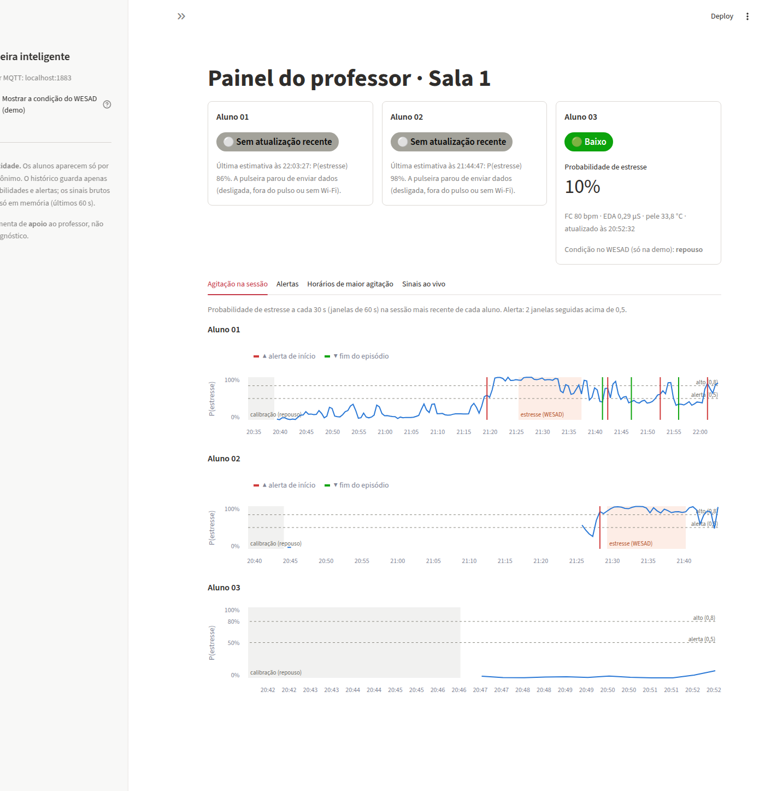
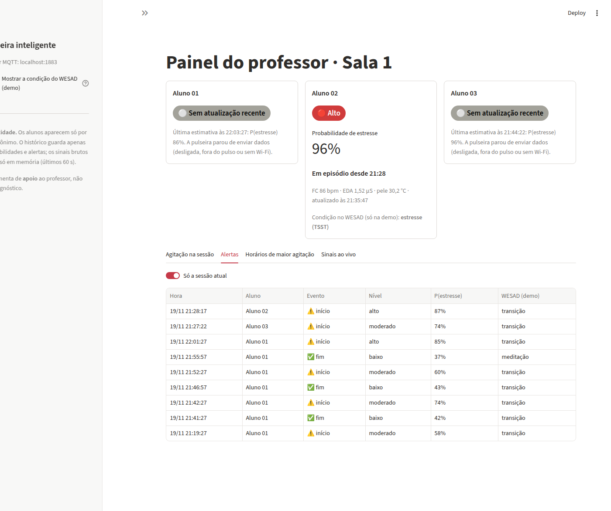
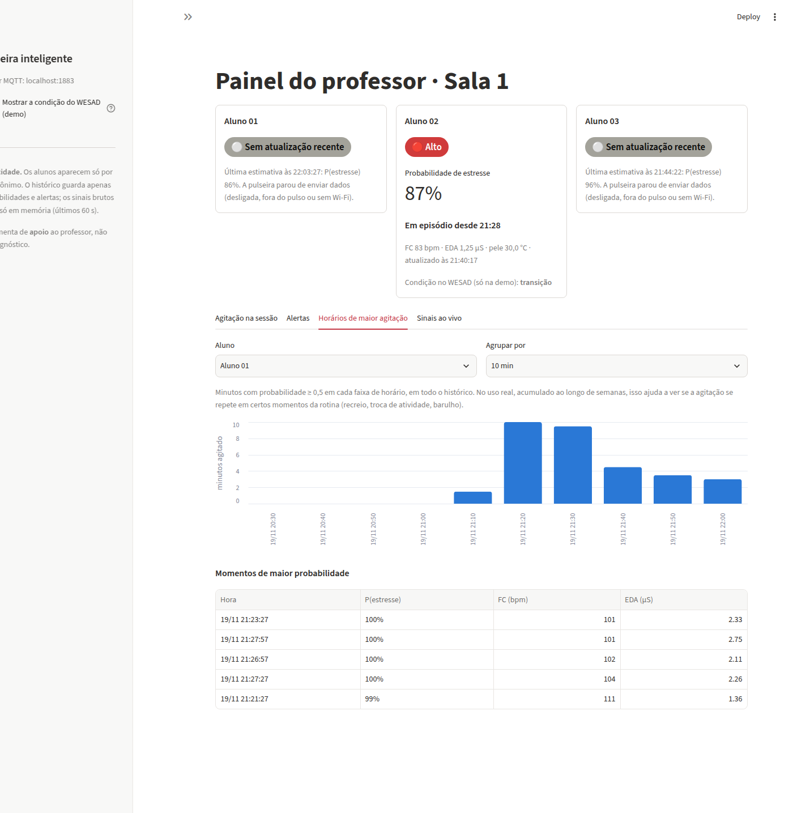
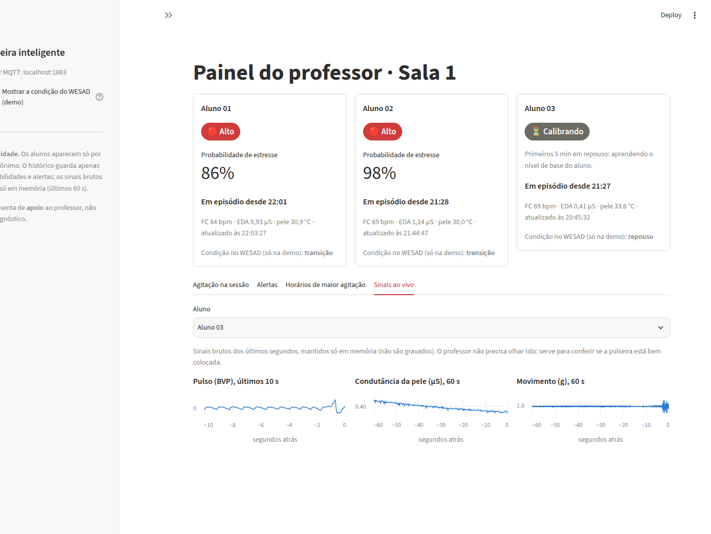

> **Rascunho gerado com apoio de IA em 19/11/2026.**
> - Os números do teste (3.7) vêm de `data/demo/agitacao.csv` e `data/demo/alertas.csv`, gerados no teste de 19/11 (modelo da demo, sem S8, S10 e S15).
> - As figuras 3.2 a 3.5 são capturas **provisórias** desse teste. Trocar pelas capturas feitas na gravação do vídeo.
> - **Reescrever com suas palavras e apagar este aviso.**

# 3 Desenvolvimento e Funcionalidades

Esta seção descreve como o protótipo foi construído e o que cada parte faz. A arquitetura e o contrato das mensagens estão na Seção 2. O protótipo funciona **de ponta a ponta**: uma pulseira virtual envia sinais pelo MQTT, o serviço de inferência estima a probabilidade de estresse, e o professor recebe o alerta no Telegram e acompanha a turma num painel.

## 3.1 Componentes

**Tabela 3.1:** Componentes do protótipo

| Componente | Arquivo | O que faz |
|---|---|---|
| Broker MQTT | `docker-compose.yml` (Mosquitto) | Recebe e distribui as mensagens entre as partes |
| Pulseira virtual | `src/iot/virtual_wristband.py` | Reproduz os sinais de pulso do WESAD como se fosse a pulseira ESP32, 1 pacote por segundo |
| Indicadores em tempo real | `src/models/predict.py` | Calcula os 18 indicadores de uma janela de 60 s, aplica a calibração e o modelo |
| Serviço de inferência | `src/iot/inference_service.py` | Mantém o estado de cada aluno, decide a cada 30 s, publica o nível de agitação e os alertas |
| Alertas no Telegram | `src/iot/telegram_alert.py` | Envia ao professor uma mensagem curta no início e no fim de cada episódio |
| Painel do professor | `dashboard/app.py` (Streamlit) | Mostra o estado de cada aluno, a evolução na sessão, os alertas e os horários de maior agitação |
| Configuração | `src/iot/config.py` e `.env` | Endereço do broker, nomes dos tópicos, modelo usado, token do Telegram |

Todo o código é em Python. Cada componente roda como um processo separado e só conversa com os outros pelo broker. Isso é o que permite trocar a pulseira virtual pela pulseira real sem mudar o resto.

## 3.2 Pulseira virtual

Como não houve pulseira física nem teste com alunos (Seção 1.5), a demonstração usa uma **pulseira virtual**. Ela lê os sinais de pulso de um participante do WESAD e publica, a cada segundo, um pacote com os mesmos campos que a pulseira ESP32 enviaria: 64 amostras de pulso (BVP), 4 de condutância da pele (EDA), 4 de temperatura e 32 de aceleração.

Três alunos fictícios foram definidos: `aluno01` (participante S10), `aluno02` (S15) e `aluno03` (S8). O pseudônimo é a única identificação que circula, como proposto na Seção 2.4.1.

Recursos da pulseira virtual:
- **Velocidade ajustável:** a sessão pode ser reproduzida mais rápido que o tempo real (por exemplo, `--velocidade 20`), para caber na demonstração.
- **Modo curto (`--curta`):** envia os 5 minutos de calibração e pula para 4 minutos antes do teste de estresse. Usado no vídeo.
- **Relógio da sessão:** o horário de cada pacote acompanha o tempo da sessão do WESAD. Quando o modo curto pula um trecho, o horário também pula, e o serviço trata isso como "pulseira sem sinal", sem misturar trechos diferentes na mesma janela.
- **Campo `rotulo`:** cada pacote leva a condição do protocolo do WESAD naquele momento (repouso, estresse, diversão, meditação). Só a pulseira virtual tem esse campo, que serve para o painel mostrar a "verdade" durante a demonstração. O serviço de inferência não o usa.

**Modelo da demonstração.** Se a demonstração usasse o modelo final, treinado com todos os 15 participantes, ela mostraria o modelo em pessoas que ele já viu no treino, e o resultado seria otimista. Por isso a demonstração usa um segundo modelo, `models/modelo_demo_sem_S8_S10_S15.joblib`, com a mesma configuração do modelo final (Random Forest, baixo custo + EDA, calibrado), mas treinado **sem os três participantes reproduzidos**. Assim, os três alunos da demo são pessoas que o modelo nunca viu, como seria um aluno novo na escola.

## 3.3 Indicadores em tempo real

No treino, os indicadores foram calculados sobre a sessão inteira de cada participante (Seção 2.6). Na pulseira, só existe o passado: a cada 30 s, o serviço tem apenas os últimos 60 s de sinal. O módulo `src/models/predict.py` recalcula os mesmos 18 indicadores nessas condições, **reaproveitando as mesmas funções do treino**, para que o modelo receba os dados no formato em que aprendeu.

A equivalência foi conferida comparando, janela a janela, os indicadores calculados em tempo real com os do treino (`python -m src.models.predict S10 <modelo>`):
- **Condutância da pele, temperatura e movimento:** praticamente idênticos (correlação ≥ 0,99).
- **Frequência cardíaca:** parecida, mas não igual (correlação de 0,5 a 0,98, conforme o indicador). O detector de batimentos (NeuroKit2) ajusta seus limiares ao trecho de sinal que recebe, e o trecho é diferente: a sessão inteira no treino, cerca de 75 s em tempo real. Aumentar a margem do trecho não resolveu.

Mesmo com essa diferença, a probabilidade de estresse continua separando bem as condições (3.7), porque a decisão do modelo se apoia principalmente na condutância da pele (Seção 4.3).

## 3.4 Serviço de inferência

O serviço assina os sinais de todas as pulseiras e mantém, para cada aluno, um estado independente:

1. **Calibração:** nos primeiros 5 minutos, com o aluno em repouso, guarda os indicadores de cada janela válida. Ao final, a média vira o nível de base do aluno. Se houver menos de 3 janelas válidas (por exemplo, muito movimento), a calibração se estende até juntar as 3.
2. **Monitoramento:** a cada 30 s, calcula os indicadores da janela de 60 s, subtrai o nível de base e aplica o modelo. Se a janela não tem qualidade suficiente (muito ruído no pulso), o estado vira `sinal_ruim` e nenhuma probabilidade é publicada.
3. **Regra de alerta:** duas janelas seguidas com probabilidade ≥ 0,5 iniciam um episódio, e duas abaixo de 0,5 o encerram. O alerta é publicado só no início e no fim, e não a cada janela.
4. **Falhas de sinal:** se a pulseira ficar mais de 5 s sem enviar, o serviço esvazia o buffer e espera 60 s de sinal contínuo antes de decidir de novo. A calibração é mantida. Se a pulseira reiniciar (o contador de pacotes volta a zero), começa uma sessão nova, com nova calibração.
5. **Histórico:** grava em `data/demo/` só as saídas: probabilidade, nível, resumo da janela (FC, EDA e temperatura médias) e alertas. Os sinais brutos ficam só em memória.

Um pacote malformado é registrado e descartado, sem derrubar o serviço.

## 3.5 Alertas no Telegram

O bot do Telegram assina o tópico de alertas e envia ao professor uma mensagem curta, com o pseudônimo, o nível e uma sugestão de ação (Figura 3.1):

> ⚠️ Aluno 02: sinais de agitação (nível alto) às 10:42.
> Sugestão: aproximar-se com calma e oferecer uma pausa sensorial.

> ✅ Aluno 02: os sinais voltaram ao normal às 10:51.

Detalhes de funcionamento:
- **Conteúdo mínimo:** como a mensagem passa por um serviço externo, ela leva só o pseudônimo e o nível, sem probabilidades nem sinais.
- **Limite de frequência:** no máximo uma mensagem do mesmo tipo a cada 30 s por aluno, para não inundar o celular do professor (ideia tirada do AutiSense; SHAHEEN; DARABEE, 2026).
- **Modo de teste:** sem o token do bot no `.env`, o serviço mostra no terminal a mensagem que enviaria. Assim a demonstração roda mesmo sem internet.
- **Configuração:** o bot é criado no @BotFather. O comando `--descobrir-chat` mostra o identificador da conversa do professor, e `--teste` envia uma mensagem de teste.

*[Figura 3.1: captura do alerta recebido no celular. Fazer na gravação do vídeo.]*

## 3.6 Painel do professor

O painel (`streamlit run dashboard/app.py`) se atualiza a cada 2 segundos e tem duas partes.

**Cartões dos alunos (topo).** Um cartão por aluno mostra, de forma que se entenda de longe:
- o **nível de agitação**, com cor, ícone e texto (🟢 baixo, 🟡 moderado, 🔴 alto), para não depender só da cor;
- a probabilidade de estresse e, se houver episódio em andamento, desde quando;
- um resumo da última janela (frequência cardíaca, condutância e temperatura da pele);
- estados especiais: **calibrando** (primeiros 5 min), **sinal ruim**, **aguardando pulseira** e **sem atualização recente** (a pulseira parou de enviar, por exemplo por estar desligada ou fora do pulso).

**Abas (embaixo).**
- **Agitação na sessão** (Figura 3.2): a probabilidade de estresse a cada 30 s, com as linhas de 0,5 (alerta) e 0,8 (alto), a faixa de calibração e as marcas dos alertas de início e fim. Na demonstração, uma faixa laranja mostra quando o protocolo do WESAD estava na fase de estresse, para comparar a estimativa com a "verdade".
- **Alertas** (Figura 3.3): a lista dos episódios, com hora, aluno, nível e probabilidade.
- **Horários de maior agitação** (Figura 3.4): minutos com probabilidade ≥ 0,5 em cada faixa de horário (10 min ou 1 hora) e os momentos de maior probabilidade. No uso real, acumulado ao longo de semanas, isso ajudaria o professor a perceber se a agitação se repete em certos momentos da rotina (recreio, troca de atividade, barulho). Essa função é uma proposta: ela não foi avaliada, porque os dados do WESAD são de uma única sessão por pessoa.
- **Sinais ao vivo** (Figura 3.5): os últimos segundos de pulso, condutância da pele e movimento de um aluno. Não é para o professor acompanhar, e sim para conferir se a pulseira está bem colocada. Esses sinais ficam só na memória do painel.

O painel recebe o estado atual pelo MQTT (a última mensagem de agitação fica retida no broker, então o painel já abre mostrando o estado de cada aluno) e lê o histórico dos arquivos gravados pelo serviço de inferência.



**Figura 3.2:** Painel do professor com três alunos. No topo, os cartões. Embaixo, a probabilidade de estresse de cada aluno na sessão: faixa cinza = calibração; faixa laranja = fase de estresse do protocolo do WESAD (só na demo); linhas vermelhas e verdes = alertas de início e de fim.



**Figura 3.3:** Lista de alertas.



**Figura 3.4:** Minutos de agitação por faixa de 10 minutos e momentos de maior probabilidade.



**Figura 3.5:** Sinais brutos recentes, usados para conferir a colocação da pulseira.

## 3.7 Teste de ponta a ponta

O sistema completo foi testado em 17/11 e 19/11/2026 com o broker, o serviço de inferência, o bot do Telegram, o painel e até três pulseiras virtuais ao mesmo tempo. A Tabela 3.2 resume o teste de 19/11.

**Tabela 3.2:** Probabilidade média de estresse por condição do WESAD, no teste de ponta a ponta (modelo da demo; nenhum dos três participantes estava no treino)

| Aluno (participante) | Sessão | Repouso | Diversão | Meditação | Estresse (TSST) | Primeiro alerta |
|---|---|---|---|---|---|---|
| aluno01 (S10) | completa | 0,11 | 0,10 | 0,28 | 0,88 | 6 min antes da fase de estresse |
| aluno02 (S15) | curta | 0,04 | — | — | 0,93 | 1 min antes |
| aluno03 (S8) | curta | 0,01 | — | — | 0,96 | 1,5 min antes |

O que o teste mostrou:
- **O estresse foi detectado nos três alunos**, com probabilidade média entre 0,88 e 0,96 durante o teste de estresse. Em repouso e diversão, a média ficou entre 0,01 e 0,11, sem alertas.
- **Os alertas vieram antes da fase marcada como "estresse".** Nos três casos, o primeiro alerta saiu na transição que antecede o teste. Nesse trecho do protocolo, o participante recebe o anúncio do teste e tem três minutos para preparar o discurso (SCHMIDT et al., 2018, p. 3). Então a antecipação é coerente com o que a pessoa vivia: a ansiedade começa antes da fala.
- **Depois do estresse, a recuperação é lenta.** No aluno01, que reproduziu a sessão completa, houve outros três episódios depois do teste: dois na transição seguinte e um que se estendeu até a segunda meditação (na meditação, a probabilidade chegou a 0,87). É o mesmo padrão visto na simulação de uso (Seção 4.5): a condutância da pele demora a voltar ao nível de base.
- **O resultado é reproduzível:** a mesma sessão do aluno02, rodada duas vezes, produziu as mesmas probabilidades e o mesmo alerta.
- **As falhas de sinal foram tratadas:** no modo curto, o salto de cerca de 40 minutos na sessão foi tratado como pulseira sem sinal, sem gerar janelas misturadas.

## 3.8 Problemas encontrados e correções

Alguns problemas só apareceram ao rodar o sistema completo:

- **Assinatura perdida após reconexão.** Quando o cliente MQTT reconectava ao broker, ele não assinava os tópicos de novo e parava de receber dados, sem nenhum erro. Correção: assinar os tópicos dentro do evento de conexão, que roda a cada reconexão. A causa da reconexão também foi corrigida: dois processos com o mesmo identificador de cliente se derrubavam no broker. Por isso, o painel usa um identificador único por execução.
- **Janelas que misturavam trechos.** No modo curto, a primeira janela depois do salto juntava sinais de dois momentos diferentes da sessão. Correção: a pulseira passou a usar o relógio da sessão, e o serviço esvazia o buffer quando há lacuna no sinal.
- **Alerta suprimido na reprodução acelerada.** O limite de uma mensagem a cada 30 s usava o relógio do computador. Com a reprodução 40 vezes mais rápida, dois episódios reais caíam no mesmo intervalo. Correção: usar o horário do próprio alerta.
- **Episódio "fantasma" no painel.** Ao reiniciar uma pulseira, o painel continuava mostrando o episódio da sessão anterior. Correção: cada mensagem passou a levar o identificador da sessão (`sessao`), e o painel filtra os alertas pela sessão atual do aluno.
- **Telegram com erro 403.** Na configuração do bot, o envio falhava porque o identificador da conversa estava errado. O serviço passou a mostrar o motivo informado pelo Telegram, o que facilita a configuração.

## 3.9 Como executar

As instruções completas estão no README do repositório (seção "Como executar a demo"). Em resumo, cada comando roda num terminal:

```bash
docker compose up -d mosquitto                              # broker MQTT
python -m src.iot.inference_service                         # serviço de inferência
python -m src.iot.telegram_alert                            # alertas no Telegram
streamlit run dashboard/app.py                              # painel do professor
python -m src.iot.virtual_wristband --aluno aluno02 --velocidade 20 --curta   # pulseira virtual
```

---

## Referências citadas nesta seção

SCHMIDT, P. et al. Introducing WESAD, a multimodal dataset for wearable stress and affect detection. In: INTERNATIONAL CONFERENCE ON MULTIMODAL INTERACTION, 20., 2018, Boulder. *Proceedings* [...]. New York: ACM, 2018. p. 400-408. DOI: 10.1145/3242969.3242985.

SHAHEEN, B.; DARABEE, R. *AutiSense*: smart assistant system for children with autism spectrum disorder. 2026. Trabalho de Conclusão de Curso (Bacharelado em Engenharia de Sistemas Computacionais) – Palestine Polytechnic University, Hebron, 2026.
